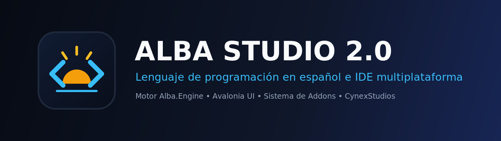

<p align="center">
  
</p>

<h1 align="center">Alba Studio &amp; Lenguaje Alba (v2.0.0)</h1>

<p align="center">
  <strong>Lenguaje de programación moderno en español y su entorno de desarrollo integrado multiplataforma (Windows, macOS y Linux).</strong>
</p>

<p align="center">
  Desarrollado por <a href="https://github.com/CynexStudios">CynexStudios</a> • Versión actual: <code>2.0.0</code> • Licencia: <a href="LICENSE">Apache 2.0</a>
</p>

---

## Captura de pantalla

> **[MARCADOR DE CAPTURA]:** Coloca aquí la captura definitiva de **Alba Studio 2.0.0** una vez compilado (`assets/branding/captura-alba-studio-2.0.png`).

---

## Características principales

- **Lenguaje propio en español (`Alba`, extensión `.alb`):** Combina legibilidad inspirada en Python (sin punto y coma obligatorio, inferencia de tipos) con estructura de bloques `{ }` y clases inspiradas en C# (`publico`, `privado`, `constructor`, `intentar`/`capturar`/`finalmente`).
- **Motor independiente (`Alba.Engine`):** Analizador léxico, parser recursivo descendente, AST inmutable, intérprete y catálogo de errores en español (`ALB-Lxxx`, `Sxxx`, `Txxx`, `Exxx`).
- **Alba Studio 2.0 (`Alba.IDE`):**
  - Pantalla de bienvenida moderna con historial persistente de proyectos/archivos recientes y novedades de versión.
  - Sistema de **3 temas** (*Alba Crepúsculo*, *Alba Medianoche*, *Alba Amanecer*) y personalización hexadecimal de colores de sintaxis.
  - **Diagnóstico en vivo** en segundo plano con subrayado rojo en el editor y panel **Problemas**.
  - **Terminal integrada real** (PowerShell en Windows, `bash`/`sh` en Linux y macOS), **Paleta de Comandos** (`Ctrl+Shift+P`), apertura rápida (`Ctrl+P`) y búsqueda global en proyectos (`Ctrl+Shift+F`).
  - Autoguardado configurable, recuperación de sesión, atajos de teclado editables y visor integrado de documentación.
- **Sistema extensible de complementos (`/addons`):** Soporte nativo para añadir nuevos lenguajes con validación de seguridad (`ValidadorAddons`) y aislamiento en directorio de usuario. Incluye complemento funcional para **Python 3**.
- **CLI (`alba`) y Host Nativo C++20 (`alba-host`):** Ejecución y verificación por consola sin abrir el IDE.

---

## Tecnologías utilizadas

| Componente | Tecnología |
| :--- | :--- |
| Motor del lenguaje y CLI | C# 12 / .NET 8.0 |
| Interfaz de escritorio (IDE) | Avalonia UI `11.2.1` + AvaloniaEdit `11.1.0` |
| Lanzador nativo portable | C++20 (`std::filesystem`, procesos nativos) |
| Orquestación multiplataforma | CMake ≥ 3.25 + CTest |
| Empaquetado nativo | Inno Setup 6 (Windows), `.app`/`.dmg` (macOS), `.deb`/`.rpm`/`.AppImage` (Linux) |

---

## Descarga e instalación (usuarios finales)

Los paquetes autocontenidos **no requieren instalar .NET SDK ni herramientas de desarrollo**.

- **Descargas oficiales:** [GitHub Releases — CynexStudios/alba-ecosistema](https://github.com/CynexStudios/alba-ecosistema/releases) *(disponibles al publicar la etiqueta `v2.0.0`)*

### Windows (`win-x64`)
1. Descarga `AlbaStudio-2.0.0-win-x64-setup.exe` (o el archivo portable `.zip`).
2. Ejecuta el instalador guiado, elige la carpeta de instalación y opcionalmente marca la asociación de archivos `.alb` y el comando `alba` en tu `PATH`.

### macOS (`osx-arm64` Apple Silicon / `osx-x64` Intel)
1. Descarga el `.dmg` correspondiente a tu procesador.
2. Arrastra **Alba Studio.app** hacia **Aplicaciones**.
3. *(Nota si aún no está firmado con Developer ID: la primera vez haz clic derecho → Abrir para autorizarlo en Gatekeeper).*

### Linux (`linux-x64`)
- **Debian / Ubuntu / Mint:**
  ```bash
  sudo apt install ./AlbaStudio-2.0.0-linux-x64.deb
  ```
- **Fedora / RHEL:**
  ```bash
  sudo dnf install ./AlbaStudio-2.0.0-linux-x64.rpm
  ```
- **Universal portable (AppImage):**
  ```bash
  chmod +x AlbaStudio-2.0.0-linux-x64.AppImage
  ./AlbaStudio-2.0.0-linux-x64.AppImage
  ```

---

## Compilación desde código fuente (desarrolladores)

### Requisitos
- **SDK de .NET 8.0** (o compatible con `net8.0`)
- **CMake ≥ 3.25**
- **Compilador C++20:** MSVC / Visual Studio (Windows), Clang/Xcode (macOS) o GCC 11+ (Linux)

### Comandos de compilación y pruebas
```bash
# Windows (PowerShell)
cmake --preset windows-auto
cmake --build --preset windows-auto
ctest --preset windows-auto

# Linux
cmake --preset linux-release
cmake --build --preset linux-release
ctest --preset linux-release

# macOS (Apple Silicon o Intel)
cmake --preset macos-arm64-release   # o macos-x64-release
cmake --build --preset macos-arm64-release
ctest --preset macos-arm64-release
```

---

## Ejemplo de código en Alba (`.alb`)

```text
# Ejemplo: Clases y manejo de errores en Alba
clase CuentaBancaria {
    privado decimal saldo

    constructor(decimal inicial) {
        este.saldo = inicial
    }

    publico funcion depositar(decimal monto) -> decimal {
        si monto <= 0 {
            lanzar "El monto debe ser positivo"
        }
        este.saldo = este.saldo + monto
        retornar este.saldo
    }
}

intentar {
    variable cuenta = nuevo CuentaBancaria(100.0)
    imprimir("Nuevo saldo: " + convertir_texto(cuenta.depositar(50.5)))
} capturar error {
    imprimir("Error controlado: " + error)
}
```

---

## Estructura del proyecto

```text
alba-ecosistema/
├── .github/                  # Plantillas de GitHub y workflows de CI/CD
├── addons/                   # Complementos integrados (ej: Python 3)
├── assets/                   # Logos, iconos (.ico/.icns/.png), branding y temas
├── docs/                     # Documentación completa del lenguaje e IDE (01..08)
├── examples/                 # Programas de ejemplo en Alba (.alb)
├── native-launcher/          # Host nativo portable en C++20 (alba-host)
├── packaging/                # Scripts de instaladores (Windows, macOS, Linux)
├── src/
│   ├── Alba.Engine/          # Lexer, Parser, AST, Diagnósticos e Intérprete
│   ├── Alba.CLI/             # Herramienta de línea de comandos (alba)
│   └── Alba.IDE/             # IDE nativo Alba Studio 2.0 (Avalonia UI)
├── tests/                    # Pruebas unitarias (Motor, IDE y Host C++)
├── AlbaEcosistema.sln
├── CMakeLists.txt
├── CMakePresets.json
└── Directory.Build.props     # Versionado centralizado (2.0.0)
```

---

## Sistema de Addons

Alba Studio separa los complementos integrados (directorio de instalación) de los instalados por el usuario (`%APPDATA%\AlbaStudio\addons` en Windows, `~/Library/Application Support/AlbaStudio/addons` en macOS, `~/.config/AlbaStudio/addons` en Linux). Consulta [`docs/07_guia_de_addons.md`](docs/07_guia_de_addons.md) para crear nuevos addons con resaltado `.xshd` y snippets propios.

---

## Estado del desarrollo y Hoja de ruta

- **Estado actual (`v2.0.0`):** Motor funcional completo, CLI, IDE renovado con temas/diagnóstico en vivo/terminal y sistema de empaquetado listo para Windows, macOS y Linux.
- **Hoja de ruta próxima (`v2.1.x+`):**
  - Depurador paso a paso con puntos de interrupción visuales.
  - Autocompletado contextual de símbolos del proyecto (clases y funciones propias en `.alb`).
  - Integración visual con Git desde la barra lateral.
  - Firma digital oficial de paquetes para Windows SmartScreen y macOS Gatekeeper.

---

## Documentación, Licencia y Soporte

- **Documentación completa:** Carpeta [`docs/`](docs/01_introduccion_y_filosofia.md) o dentro del IDE en **Ayuda → Documentación**.
- **Licencia:** Distribuido bajo **Apache License 2.0** ([`LICENSE`](LICENSE) y [`NOTICE`](NOTICE)). Copyright © 2026 **CynexStudios**.
- **Soporte:** Consulta [`SUPPORT.md`](SUPPORT.md) o abre una incidencia en [GitHub Issues](https://github.com/CynexStudios/alba-ecosistema/issues).

---

## English Summary

**Alba Studio 2.0.0** is an open-source Spanish-syntax programming language (**Alba**, `.alb`) and cross-platform native desktop IDE built with **.NET 8**, **Avalonia UI 11**, **AvaloniaEdit**, and a portable **C++20** host (`alba-host`). It features live syntax diagnostics, customizable dark/light themes, an integrated OS terminal, command palette, extensible language addons, and automated cross-platform installers for Windows, macOS (Apple Silicon & Intel), and Linux under the **Apache 2.0 License** by **CynexStudios**.
